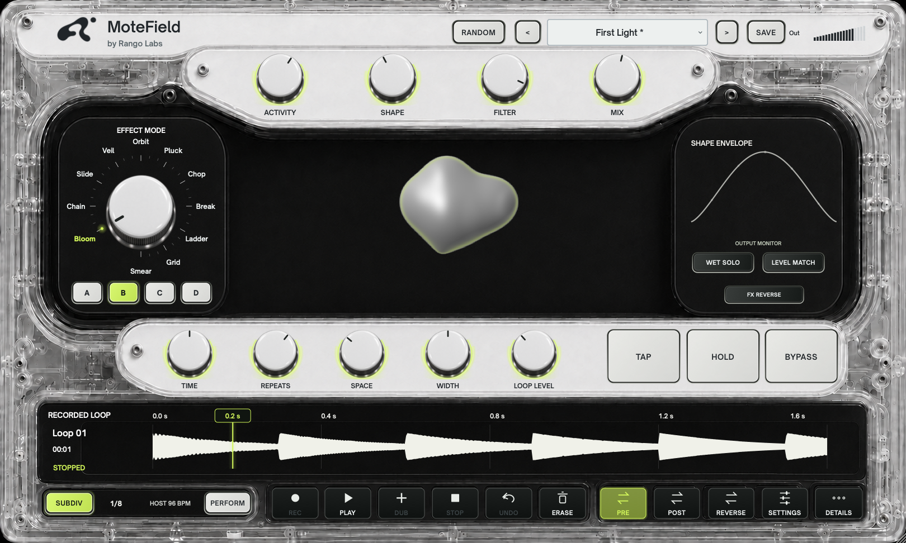

# MoteField by Rango Labs

MoteField is a free audio effect plug-in that turns incoming sound into layered micro loops, granular clouds, rhythmic glitches and spatial repeats. It has **11 effect modes** with A–D variations, **43 factory presets**, a **60-second phrase looper**, and an audio-reactive fluid display, in a hardware-style interface.



**Formats:** VST3 and AU on macOS (universal Apple Silicon/Intel), AAX Native for Pro Tools on macOS, VST3 on Windows x64. Linux VST3 builds from source.

- [Download and install](#download-and-install)
- [Features](#features)
- [Build from source](#build-from-source)
- [Tests](#tests)
- [License](#license)

## Download and install

Installers are published on this repository's **Releases** page.

### macOS

Download the `.pkg` installer and open it. It's signed and notarized by Apple. On the Installation Type screen, choose which formats to install: **AU**, **VST3** and **AAX** (Pro Tools). All three are selected by default. Plug-ins go to the standard system folders:

- `/Library/Audio/Plug-Ins/Components/MoteField.component`
- `/Library/Audio/Plug-Ins/VST3/MoteField.vst3`
- `/Library/Application Support/Avid/Audio/Plug-Ins/MoteField.aaxplugin`

Reopen your DAW and rescan plug-ins if needed. Requires macOS 11 or later.

### Windows

Windows is **VST3 only** for now. Pro Tools on Windows (AAX) isn't supported yet.

1. Save your session and close your DAW.
2. Run `MoteField-<version>-Windows-x64-UNSIGNED.exe`.
3. The installer isn't code-signed yet, so Windows SmartScreen may show **"Windows protected your PC"**. Click **More info**, then **Run anyway**. This is a reputation warning about an unrecognised publisher, not a virus detection. Only run the installer from this repository's Releases page, and don't turn off SmartScreen or Defender.
4. Approve the administrator prompt and finish the installer.
5. Reopen your DAW and rescan VST3 plug-ins.

The plug-in installs to `C:\Program Files\Common Files\VST3\MoteField.vst3`. Uninstall from **Settings > Apps > Installed apps**.

### First sound

Put MoteField on an audio track that's receiving signal, choose the **First Light** preset, raise **Mix**, and try **Hold** on a sustained chord. Mono, stereo and mono-in/stereo-out tracks are supported.

## Features

### Effect modes

Turn the mode dial or click a mode's name. **A–D** selects a variation, which changes playback patterns, pitch behavior or delay arrangement depending on the mode.

| Family | Mode | What it does |
| --- | --- | --- |
| Micro Loops | **Bloom** | Layers overlapping phrases at related playback speeds. Variations add upper octaves, lower octaves or a cycling speed pattern. |
| Micro Loops | **Chain** | Reads recent audio in a repeating slice sequence to build rhythmic phrases. Variations add half-speed and octave playback; D adds stepped amplitude quantization. |
| Micro Loops | **Slide** | Bends playback speed within each loop for rising, falling or alternating pitch sweeps. |
| Granules | **Veil** | Scatters many small grains across recent audio into a diffuse cloud, from slight detuning to octave layers. |
| Granules | **Orbit** | Overlaps long grains from different points in the capture for sustained, slowly evolving textures. |
| Granules | **Pluck** | Starts grains at detected note attacks, keeping fragments tied to the source's articulation. |
| Glitch | **Chop** | Replays short slices as rapid rhythmic cuts; note attacks can retrigger the pattern. |
| Glitch | **Break** | Produces intermittent bursts with gaps between them; detected attacks can trigger fresh fragments. |
| Glitch | **Ladder** | Steps fragments through repeating pitch-ratio sequences: ascending, descending, octave or reordered. |
| Multi Delay | **Grid** | Tempo-related stereo tap patterns. Activity sets tap count, Repeats sets feedback, A–D selects the timing arrangement. |
| Multi Delay | **Smear** | Blends multi-tap delay with granular playback and independently filtered taps. |

### Main controls

| Control | Role |
| --- | --- |
| **Activity** | Event density, overlapping voice count or delay tap count, depending on the mode. |
| **Shape** | Volume contour of new grains; also grain length in Veil and delay character in Smear. |
| **Filter** | Low-pass cutoff (Resonance is in Details). |
| **Mix** | Dry/effect balance. |
| **Time** | Rhythmic subdivision when synced, or internal tempo in manual mode. |
| **Repeats** | Grain duration and regeneration, depending on the mode. |
| **Feedback** | Trims regeneration and shortens repeats; 100% keeps the preset's full behavior. |
| **Space** | Reverb amount. Bright, Dark, Hall and Infinite characters are in Details. |
| **Width** | 0% mono, 100% original; above 100% gently widens (capped at +10% side gain, mono sum unchanged). |
| **Loop Level** | The recorded phrase's contribution. |

Drag a knob vertically or scroll to adjust it, hold Shift for fine control, and double-click to reset. **TAP** sets a manual tempo (40–240 BPM); **SUBDIV** follows host tempo when available. **HOLD** freezes the recent capture while playback continues. **BYPASS** smoothly returns to the dry signal while the engine and looper keep running.

**Details** opens modulation (Drift depth/rate), resonance, output trim, reverb character, **Reverb Solo**, subdivision, loop speed, **Wet Solo**, **Level Match** (automatic ±12 dB input/output loudness matching) and **Less Motion**.

### Reactor display

The translucent fluid in the center reacts to the sound: bass changes its pressure and stretch, mids its contour, treble its surface tension, and active voices form bodies that merge and split.

It's also a controller. Drag horizontally to scan older captured audio and vertically to transpose by up to two octaves. Shift-drag changes grain stretch; Option/Alt-drag splits voices. Double-click resets scan, stretch and split and keeps your transpose. **PITCH LOCK** protects transpose while you drag. Every gesture writes ordinary automatable parameters, so your DAW can record the movements.

### Tuning

Click **TRANSPOSE** to open the tuning page: transpose ±24 semitones, fine tuning in cents, and an **A4 reference** (custom, or 432/440 Hz shortcuts) for sources tuned away from 440 Hz. Many modes add their own built-in intervals on top of transpose. The readout shows that **mode pattern** (for example `MODE 0 +4 +7 +12 st`), so you can see what you hear even when transpose is 0.

### Phrase looper

Record up to 60 seconds and layer it independently of the effect.

| Control | Action |
| --- | --- |
| **Rec** | Start recording; press again to close the recording and play it. |
| **Play / Stop** | Resume or stop playback, keeping the phrase. |
| **Dub** | Start or finish an overdub pass. |
| **Undo / Erase** | Remove the newest overdub, or clear everything. |
| **Pre / Post** | Place the looper before or after the effects. |
| **Reverse** | Reverse phrase playback, independent of FX Reverse. |

Loop joins are crossfaded automatically (20 ms default). In the waveform strip you can drag **Start/End**, move the whole region, adjust the crossfade, and snap to 1/16 notes. Recorded loops save with DAW projects and user presets, and survive copying the plug-in between tracks.

### Performance (PERFORM)

- **Loop & Capture:** quantized recording starts, one-bar count-in, fixed 1/2/4/8-bar lengths, continuous 0.25–4× loop speed, loop fades, Burst (hold-to-record), bypass trails, **Capture 1/2/4 bars** of recent output, and **Export / Drag Loop WAV** straight into your DAW.
- **Material & Magnet:** Viscosity, Cohesion and Tension shape how the field moves. The mono **Magnet** sidechain lets another track compress, trigger or attract the voices.
- **Pattern & MIDI:** repeatable pattern seeds, pattern lock, rhythm and pitch mutation, scale constraints, **MIDI Learn** for any parameter, and program changes 1–43 for factory presets.

### Presets, randomizing and automation

- **43 factory presets** grouped by mode, plus Reactor Explorations and tuned starting points.
- **SAVE** stores user presets as portable `.motefield` files, including recorded loop audio:
  - macOS: `~/Library/Rango Labs/MoteField/Presets`
  - Windows: `%APPDATA%/Rango Labs/MoteField/Presets`
- **RANDOM** creates a new sound within musical ranges without touching your loop, tempo or output level.
- **Initialize sound** gives a simple starting point for the current mode, with one-step undo.
- All **71 parameters** are automatable, including mode, variation, Hold, Bypass and looper commands.

### Appearance

Open **Settings** for dark mode and a custom accent color (picker, RGB or hex). The accent lights the knob rings, selected controls, loop playhead and reactor reflections. Appearance is saved per computer, separately from presets.

## Build from source

MoteField uses **C++20**, **CMake 3.22+** and **JUCE 8**, which is fetched automatically at a pinned version during configuration.

### macOS

Requires full Xcode, selected as the active developer directory.

```sh
bash scripts/build-macos.sh      # universal AU + VST3, runs the DSP tests, stages to dist/macos
bash scripts/install-macos.sh    # per-user install with backup; close your DAW first
```

The script installs to `~/Library/Audio/Plug-Ins/VST3` and `~/Library/Audio/Plug-Ins/Components`. Build an unsigned development installer with `bash scripts/package-macos.sh --unsigned`.

### Windows

Requires Visual Studio with *Desktop development with C++*, CMake, Git and PowerShell 7. From a developer terminal:

```powershell
./scripts/build-windows.ps1                 # x64 VST3 + tests
./scripts/package-windows.ps1 -Unsigned     # optional .exe installer (needs Inno Setup 6.3+)
```

`./scripts/package-friend-windows.ps1` builds a ZIP with an `Install.cmd` script instead.

### Linux

Install JUCE's platform dependencies (X11, ALSA, OpenGL, FreeType, fontconfig), then:

```sh
cmake -S . -B build -DCMAKE_BUILD_TYPE=Release
cmake --build build --parallel 2
ctest --test-dir build --output-on-failure
```

Artifacts are in `build/MoteField_artefacts/Release`; copy the `.vst3` bundle to `~/.vst3/`.

### AAX (Pro Tools)

Enable AAX with `MOTEFIELD_BUILD_AAX=ON bash scripts/build-macos.sh`, `./scripts/build-windows.ps1 -AAX`, or `-DMOTEFIELD_BUILD_AAX=ON`. JUCE's bundled AAX SDK is used by default; set `MOTEFIELD_AAX_SDK_PATH` to use another. Unsigned AAX builds only load in **Pro Tools Developer**. Retail Pro Tools requires the build to be signed with PACE tools under your own Avid/PACE developer account.

### Continuous integration

[`.github/workflows/build.yml`](.github/workflows/build.yml) builds and tests macOS and Windows on every push to `main` and on manual dispatch. It also produces unsigned installers.

## Tests

```sh
ctest --test-dir build-macos -C Release --output-on-failure
```

The DSP suite covers every mode/variation, buffer-size determinism, Hold, overdub/undo, frequency response, oversized buffers and allocation-free audio processing. A click suite checks isolated grains for discontinuities.

An optional native harness checks presets, automation notifications, layout, tuning, state recall and mono/stereo bus routing:

```sh
cmake -S . -B build -DMOTEFIELD_BUILD_PREVIEW=ON -DCMAKE_BUILD_TYPE=Release
cmake --build build --target MoteFieldPreview --config Release
./build/MoteFieldPreview /absolute/path/to/output --stills-only
```

## License

MoteField's source is released under the [MIT License](LICENSE). JUCE and its bundled dependencies keep their own license terms. Open Sauce Sans font notices are in [Assets/OFL.txt](Assets/OFL.txt). AAX is a trademark of Avid Technology; VST is a trademark of Steinberg Media Technologies.
